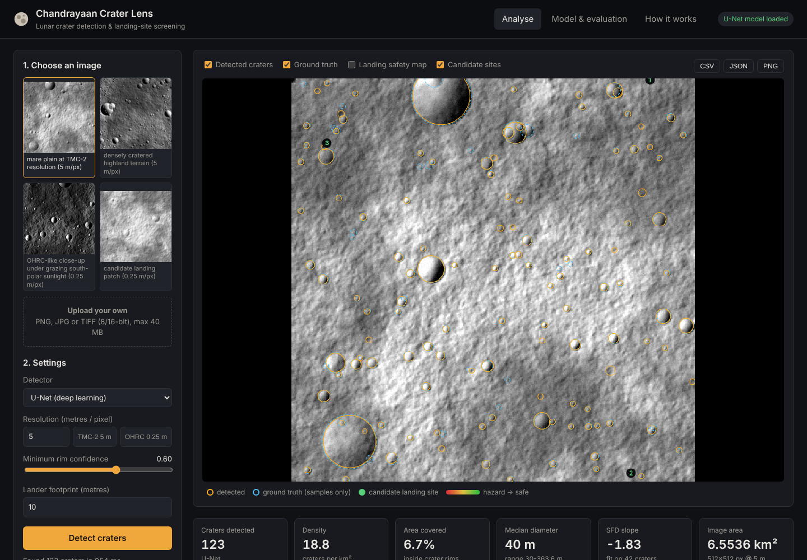
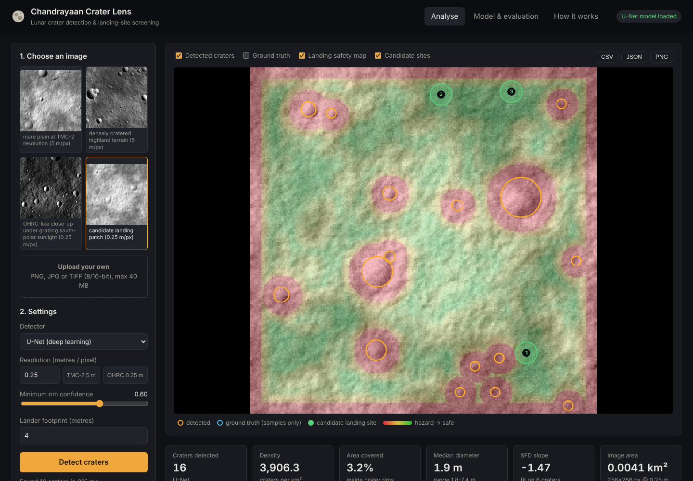
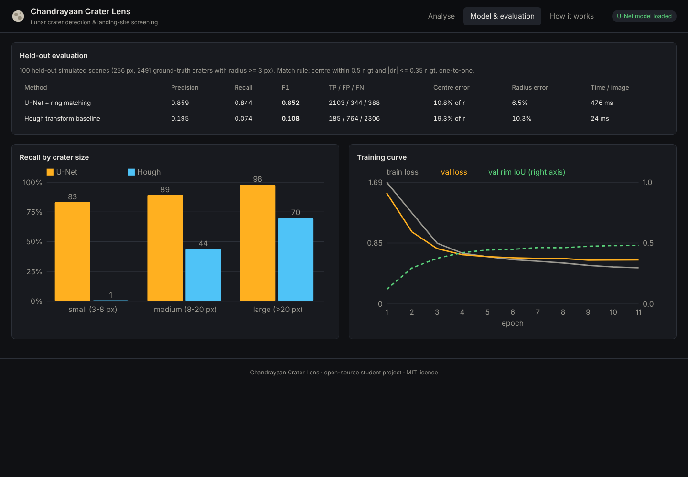

# Chandrayaan Crater Lens

**Automatic lunar crater detection, crater statistics and landing-site screening for Chandrayaan-2 style orbital images. It runs on an ordinary laptop with no GPU.**

**Live demo:** https://huggingface.co/spaces/agrawalaarush08/chandrayaan-crater-lens (browser demo: the same U-Net
and analysis code run in your browser; the full app runs locally, see [Browser demo](#browser-demo))

Upload a lunar image (or pick a built-in sample). A small U-Net neural network marks crater rims and every crater is
converted into a circle with a position, a diameter in metres and a confidence. The app then reports crater density,
the area covered by craters and the size-frequency distribution, and it suggests the flattest crater-free spots for
a lander of a size you choose.

> Independent student project. It is **not** affiliated with or endorsed by ISRO. The neural network is trained on
> *simulated* lunar terrain with exact ground truth (see [Training data](#training-data)), and all accuracy numbers
> below were measured on held-out simulated scenes. They are not measurements on real Chandrayaan images.



---

## Contents

1. [Features](#features)
2. [Quick start](#quick-start)
3. [Using the app](#using-the-app)
4. [Using real Chandrayaan-2 data](#using-real-chandrayaan-2-data)
5. [How it works](#how-it-works)
6. [Results](#results)
7. [Command line](#command-line)
8. [REST API](#rest-api)
9. [Testing](#testing)
10. [Project structure](#project-structure)
11. [Tech stack](#tech-stack)
12. [Limitations](#limitations)
13. [References](#references)
14. [License](#license)

---

## Features

| Area | What you get |
|------|--------------|
| **Crater detection** | U-Net rim segmentation with ring-template extraction (DeepMoon-style). Tiled inference with overlap plus an image pyramid, so it works on any image size from 32 px upwards. A classical **Hough-transform baseline** is included for comparison. |
| **Interactive viewer** | Detected craters, ground truth (for samples), a landing-safety heat map and candidate sites as switchable layers. Hover over a crater to see its diameter and confidence; the matching catalogue row is highlighted. |
| **Crater science** | Crater catalogue in metres, crater density (per km²), the percentage of the area covered by craters, the median, minimum and maximum diameter, and the **cumulative size-frequency distribution** (log-log) with a power-law slope fitted above the completeness diameter. |
| **Landing-site screening** | For a lander footprint you choose, every pixel is scored by its distance to the nearest crater hazard and by a local roughness proxy. The best separated sites are proposed, and each one is marked *fits* or *too tight*. |
| **Model & evaluation page** | Precision, recall and F1 on held-out scenes, centre and radius error, recall by crater size, inference time, and the training curves. The U-Net and the Hough baseline are shown side by side. |
| **Real data support** | PNG, JPG and TIFF files (8-bit, 16-bit or float) in the browser. On the command line it also reads **PDS4 products** (the format PRADAN uses for Chandrayaan-2), and a tiling script turns long OHRC and TMC-2 strips into browser-sized tiles. |
| **Exports** | Crater catalogue as CSV, full analysis as JSON, annotated image as PNG. |
| **Runs offline** | Uses no paid APIs and no cloud services. The trained model (7.5 MB) and the demo images are in the repository. |

<table>
<tr><td></td><td></td></tr>
</table>

---

## Quick start

You need **Python 3.10 or newer** ([download](https://www.python.org/downloads/); on Windows tick *"Add python.exe to PATH"*)
and Git. The first start downloads about 250 MB of packages.

**Windows (PowerShell)**

```powershell
git clone https://github.com/aarushagrawal267-maker/chandrayaan-crater.git
cd chandrayaan-crater
Set-ExecutionPolicy -Scope Process -ExecutionPolicy Bypass   # only if scripts are blocked
.\start.ps1
```

**macOS / Linux**

```bash
git clone https://github.com/aarushagrawal267-maker/chandrayaan-crater.git
cd chandrayaan-crater
./start.sh
```

Then open **http://localhost:8000**. The start scripts create a virtual environment in `.venv`, install the
requirements once, and launch the server. Press `Ctrl+C` to stop.

**Manual start (any OS)**

```bash
python -m venv .venv
# Windows: .venv\Scripts\activate      macOS/Linux: source .venv/bin/activate
pip install -r requirements.txt
uvicorn app.main:app --port 8000
```

`requirements.txt` takes the newest compatible packages. To get the exact versions the evaluation in
`models/metrics.json` was last reproduced with (Python 3.12+), install `requirements-lock.txt` instead.

**Docker (optional)**. The Dockerfile follows the manual steps above. It was written without a Docker daemon available, so it has not been test-built yet.

```bash
docker build -t crater-lens .
docker run -p 8000:8000 crater-lens
```

### Browser demo

The [live demo](https://huggingface.co/spaces/agrawalaarush08/chandrayaan-crater-lens) is a static page that needs
no server. It serves the normal web UI, and a small script (`deploy/browser/browser-api.js`) answers the UI's
`/api/*` requests inside the browser:

* the U-Net runs as an ONNX export of `models/crater_unet.pt` in [onnxruntime-web](https://onnxruntime.ai/);
* tiling, ring extraction, merging, statistics and landing-site screening are the same `lunarcrater` Python code,
  run by [Pyodide](https://pyodide.org/) (`deploy/browser/web_api.py` mirrors `POST /api/detect`).

Differences from the full app: images are analysed at up to 1024 px (2048 px locally), the first visit downloads
about 30 MB (Python runtime, NumPy, OpenCV and the model), and there is no training or evaluation. When the demo is
built, the ONNX model is compared with PyTorch on every tile the detector produces for the four samples (largest
difference 3e-6 in rim probability; identical crater lists), and `tests/test_browser_demo.py` checks that the demo's
request handling gives the same result as the API. Rebuild and publish it with:

```bash
pip install onnx onnxruntime huggingface_hub
python deploy/browser/build.py --out build/browser-demo [--space <hf-user>/chandrayaan-crater-lens]
```

---

## Using the app

1. **Choose an image.** Click one of the four simulated samples (mare plain, cratered highland, low-sun south-polar
   close-up, landing patch) or drag in your own PNG/JPG/TIFF.
2. **Set the resolution.** This is the image's size in metres per pixel. Use the presets for TMC-2 (5 m) and OHRC
   (0.25 m), or type a value. All diameters, densities and the landing analysis depend on it.
3. **Pick a detector.** *U-Net* is the trained model and *Hough* is the classical baseline. Raise the minimum rim
   confidence for fewer but surer craters.
4. **Set the lander footprint.** This is the diameter of the area the lander needs, in metres.
5. Click **Detect craters**. Switch the layers on and off, hover over craters, and read the cards, the
   size-frequency chart, the candidate sites and the catalogue. Download the CSV, JSON or PNG.

On a sample image the *Ground truth* layer and the *Vs ground truth* card show how many of the simulated craters
were found.

---

## Using real Chandrayaan-2 data

ISRO publishes Chandrayaan-2 data free of charge through the **PRADAN** portal of the Indian Space Science Data
Centre. Registration is required, so this repository cannot download the data for you.
Never put your PRADAN password, cookies or a `.netrc` file in this folder's tracked files; `.gitignore` already
excludes `.env`, `.netrc`, `cookies.txt` and key files.

1. Create an account at <https://pradan.issdc.gov.in> and open the Chandrayaan-2 section.
2. Download a calibrated product from **TMC-2** (Terrain Mapping Camera 2, about 5 m/px) or **OHRC** (Orbiter High
   Resolution Camera, about 0.25 m/px). Each product is an `.xml` label plus an `.img` data file. Keep them in the
   same folder, for example `data/`. That folder is ignored by Git.
3. Cut the strip into tiles (OHRC is so detailed that downsampling 2-4× is a good idea):

   ```bash
   python scripts/prepare_chandrayaan.py data/<product>.xml --mpp 5 --out data/tmc_tiles
   python scripts/prepare_chandrayaan.py data/<ohrc_product>.xml --mpp 0.25 --downsample 4 --out data/ohrc_tiles
   ```

4. Upload a tile in the browser with the resolution printed by the script, or run the command line:

   ```bash
   python -m lunarcrater detect data/tmc_tiles/tile_r000_c000.png --mpp 5 --csv craters.csv --annotated out.png
   ```

The PDS4 reader supports 8-, 16- and 32-bit integer and float `Array_2D_Image` products. It was tested with
synthetic PDS4 files written by the test suite. It has **not** been tested on a real PRADAN download, because none
can be redistributed here.

---

## How it works

```
image ──► contrast stretch ──► U-Net (tiles + pyramid) ──► rim probability map
      ──► ring-template matching + NMS ──► crater list (x, y, r, confidence)
      ──► metres ──► density · coverage · size-frequency · landing-safety map
```

1. **Pre-processing.** 16-bit or float data is stretched between its 0.5 and 99.5 percentiles. Images longer than
   2048 px are downscaled, and the resolution is corrected to match. Each 256 px tile is standardised (zero mean, unit
   variance), which makes the detector robust to exposure differences.
2. **U-Net** (`lunarcrater/model.py`). An encoder-decoder with skip connections (4 levels, 16→256 channels, 1.94 M
   parameters) predicts the probability that each pixel lies on a crater rim. Loss = weighted binary cross-entropy +
   Dice. Large images are processed in overlapping tiles blended with a Hann window, and at ½, ¼ (and, for very large images, ⅛) scale so that
   craters bigger than the network's training range are still found.
3. **Ring extraction** (`lunarcrater/extract.py`). Ring templates for radii from 3 to 40 px (in 7 % steps) are
   matched against the probability map with normalised cross-correlation. Local maxima become candidates, and
   non-maximum suppression removes duplicates. The confidence is the mean rim probability around the circle.
4. **Analysis** (`lunarcrater/analysis.py`). Diameters are converted to metres. The cumulative size-frequency
   distribution N(≥D) per km² is fitted with a power law on log-log axes above a completeness diameter of
   1.5 × the smallest detectable crater.
5. **Landing screening.** Every crater, enlarged by 25 % for its rim and ejecta, and the image border (unknown
   terrain) are treated as hazards. A distance transform gives each pixel its clearance in metres. The score
   combines clearance with the local roughness percentile, and the top non-overlapping maxima become the candidate
   sites. Sites are never proposed within one footprint (at least 8 px) of the image edge, because the terrain
   beyond the frame is unknown.

### Training data

No openly licensed, pixel-labelled Chandrayaan crater dataset exists, so `lunarcrater/synthetic.py` simulates
one with exact labels:

* **terrain**: fractal height fields from spectral synthesis (P(f) ∝ f^-β), plus fine regolith texture;
* **craters**: radii from a truncated power law (many small, few large). Profiles follow the morphometry of fresh
  simple lunar craters (depth ≈ 0.2 D, rim height ≈ 0.04 D, ejecta decaying as r⁻³). A random *freshness* factor
  degrades older craters, and young craters overprint old ones. Craters too small to label are added as noise;
* **illumination**: Lambertian hill-shading at a random sun azimuth and a **low sun elevation (5-45°)**, as in
  polar Chandrayaan-2 imagery, followed by albedo variation, blur, gamma and sensor noise.

Training, validation and test scenes come from disjoint seed ranges, so the test scenes were never seen in training.

---

## Results

Measured with `python -m lunarcrater evaluate` on **100 held-out simulated 256 × 256 scenes**
(2,491 ground-truth craters, radius ≥ 3 px). A detection counts as correct when its centre is within 0.5 r and
its radius within 35 % of a ground-truth crater (one-to-one matching). Precision, recall and F1 are pooled over all
craters of the 100 scenes. The full report is in [`models/metrics.json`](models/metrics.json).

| Method | Precision | Recall | F1 (95 % CI†) | TP / FP / FN | Centre error‡ | Radius error‡ | Time / 256² image* |
|--------|-----------|--------|---------------|--------------|---------------|---------------|------------------|
| **U-Net + ring matching** | **0.859** | **0.844** | **0.852** (0.831-0.871) | 2103 / 344 / 388 | 10.8 % of r | 6.4 % | 476 ms |
| Hough transform baseline | 0.195 | 0.074 | 0.108 (0.091-0.124) | 185 / 764 / 2306 | 18.2 % of r | 10.0 % | 24 ms |

Recall by crater **radius** (U-Net / Hough): small 3-8 px **0.83** / 0.01 · medium 8-20 px **0.89** / 0.44 · large ≥ 20 px **0.98** / 0.70.

† Percentile bootstrap over the 100 test images (2,000 resamples). It shows how much the score moves from one set of
simulated scenes to another. It does **not** cover the gap between simulated and real images. Precision CI: U-Net
0.835-0.884, Hough 0.164-0.229. Recall CI: U-Net 0.821-0.868, Hough 0.062-0.086. Scores also vary a lot between
single images: the per-image U-Net F1 has a median of 0.85 but drops to 0.44 on the hardest test scene.

‡ Mean over all matched craters, as a fraction of the true radius.

\* `mean_inference_ms` in `metrics.json` is wall-clock CPU time per image, including the ½-scale pyramid level,
measured on a shared 4-core machine. It depends heavily on the hardware and on what else is running: on quiet
4-core machines the U-Net takes roughly 140-480 ms per image and the Hough baseline about 25 ms, and a busy machine
can be several times slower. Treat the timing as an example, not a benchmark. The scenes are generated from fixed
seeds, so re-running the evaluation reproduces the accuracy numbers exactly; only the timings change.

The Hough transform fails mostly on small craters: under a low sun a crater looks like a crescent of shadow beside a
crescent of light, not a closed circular edge. The U-Net learns that pattern. The baseline is not a straw man: a
re-tuning sweep of 36 Hough settings (Canny threshold, accumulator threshold, `dp`, blur) on 100 **validation**
scenes found no setting above F1 0.106 there, and the best of them scored F1 0.124 on the test scenes, inside the
confidence interval above. The shipped settings are kept.

**Thresholds.** The U-Net detection thresholds (ring match ≥ 0.5, rim confidence ≥ 0.6) were not tuned on the test
scenes. They are checked on 100 **validation** scenes (seeds 10,000,000-10,000,099, rendered at 256 px) with
`python -m lunarcrater evaluate --split val --min-confidence C` (ring match changed in code):

| Rim confidence → / ring match ↓ | 0.5 | 0.6 (default) | 0.7 |
|------|------|------|------|
| 0.4 | 0.803 | 0.816 | 0.827 |
| **0.5 (default)** | 0.831 | **0.838** | 0.843 |
| 0.6 | 0.736 | 0.736 | 0.737 |

(validation F1). Ring match 0.5 is clearly best. Rim confidence 0.7 is 0.005 higher than the default 0.6, which is
well inside the scatter shown by the confidence interval, so 0.6 is kept because it finds more craters
(validation recall 0.822 vs 0.813). In the app you can raise the minimum rim confidence yourself.

Training (CPU only, about 1 h in total on a shared 4-core machine). **Stage 1:** AdamW with a one-cycle schedule
(peak learning rate 2e-3, 1,600 scenes of 160 × 160 px per epoch), stopped after 8 of the 16 scheduled epochs to
limit CPU time. **Stage 2:** 3 epochs of cosine fine-tuning (learning rate 5e-4,
800 scenes per epoch). The checkpoint with the lowest validation loss is kept: epoch 9, with validation loss 0.609
and rim IoU 0.474. The per-epoch history is in [`models/training_history.json`](models/training_history.json) and
on the *Model & evaluation* page.

These numbers describe performance on simulated images. They show that the pipeline works and how much the
learned detector improves on the classical one. They are **not** an estimate of accuracy on real Chandrayaan-2
images, which would need an expert-labelled real test set (see [Limitations](#limitations)).

Re-train or re-evaluate with:

```bash
python -m lunarcrater train --epochs 16 --train-size 1600          # stage 1 (stop early if you like)
python -m lunarcrater train --init-from models/crater_unet.pt --out models/crater_unet_ft.pt \
       --schedule cosine --lr 5e-4 --epochs 3 --train-size 800     # stage 2 fine-tune
python -m lunarcrater evaluate --images 100 --model models/crater_unet_ft.pt
```

`evaluate` writes its report to `outputs/metrics_test.json` (or `outputs/metrics_val.json` with `--split val`),
which Git ignores, so trying things out never changes the published numbers. Add `--out models/metrics.json` only
when you mean to replace the report that the app and this README show.

---

## Command line

```bash
python -m lunarcrater make-samples                     # regenerate samples/ (deterministic)
python -m lunarcrater train [--epochs N --train-size N]
python -m lunarcrater evaluate [--images N] [--split test|val] [--min-confidence 0.6] [--out report.json]
python -m lunarcrater detect IMAGE --mpp 5 [--method unet|hough] [--min-confidence 0.6]
                             [--footprint 10] [--csv out.csv] [--json out.json] [--annotated out.png]
```

`IMAGE` may be a PNG/JPG/TIFF or a PDS4 `.xml` label.

---

## REST API

Interactive documentation is at **http://localhost:8000/docs** while the server is running.

| Method | Path | Purpose |
|--------|------|---------|
| GET | `/api/health` | status, version, whether the U-Net model loaded (the model is loaded once at start-up; `model_error` explains a missing or corrupt model file) |
| GET | `/api/samples` | list of demo images (`/api/samples/{file}` returns the PNG) |
| POST | `/api/detect` | multipart form: `file` **or** `sample`, `method`, `meters_per_pixel`, `min_confidence`, `lander_footprint_m`. Returns the catalogue, stats, SFD, landing sites and PNG overlays (base64). Detections run one at a time; extra requests wait their turn |
| GET | `/api/model` | evaluation report and training history |

```bash
curl -F file=@tile.png -F meters_per_pixel=5 http://localhost:8000/api/detect
```

---

## Testing

```bash
python -m pytest
```

The same suite runs automatically on GitHub Actions for every push (`.github/workflows/tests.yml`). A second job
runs [gitleaks](https://github.com/gitleaks/gitleaks) over the full Git history and fails if a password, API key
or private key is ever committed.

The suite has 61 tests. They cover the simulator, a one-epoch training and fine-tuning run, the train/validation/test seed split, ring extraction, the matching metrics and their bootstrap confidence intervals, the image loaders
(including PDS4), the analysis maths, the detector (an untrained model for shape and tiling checks, plus a
regression check that the shipped weights reach F1 > 0.5 on held-out scenes), every API endpoint and its error
cases (including a corrupt model file, which gives a clear 503 instead of a crash, and parallel requests, which are queued), the CLI, the tiling script, and the browser demo's request handling (same results as the API).

---

## Project structure

```
chandrayaan-crater/
├── app/
│   ├── main.py              FastAPI backend (API + serves the UI)
│   └── static/              single-page UI: index.html, app.js, style.css (no build step)
├── lunarcrater/
│   ├── synthetic.py         lunar terrain + crater simulator with exact labels
│   ├── model.py             CraterUNet
│   ├── train.py             training loop (CPU)
│   ├── extract.py           probability map → circles (template matching + NMS)
│   ├── classical.py         Hough-transform baseline
│   ├── detect.py            tiled / multi-scale detection API
│   ├── metrics.py           crater matching, precision / recall / F1
│   ├── evaluate.py          held-out evaluation report
│   ├── analysis.py          catalogue, SFD, density, landing-site screening
│   ├── imageio.py           PNG/JPG/TIFF + PDS4 loading
│   └── cli.py               command line
├── models/                  crater_unet.pt (7.5 MB), metrics.json, training_history.json
├── samples/                 4 simulated demo images + ground truth (samples.json)
├── scripts/prepare_chandrayaan.py   tile real PRADAN products
├── tests/                   pytest suite
├── deploy/browser/          static browser demo (ONNX + Pyodide) and its build script
├── docs/screenshots/
├── start.sh / start.ps1     one-command setup + launch
├── Dockerfile
└── requirements.txt / requirements-lock.txt   (lock = exact tested versions)
```

---

## Tech stack

Python 3.10+ · PyTorch (CPU) · OpenCV · NumPy · FastAPI + Uvicorn · plain HTML/CSS/JavaScript with SVG charts (no
framework, no build) · pytest.

---

## Limitations

* **Simulated training data.** The model has only seen simulated terrain. Real images contain things the simulator
  lacks: secondary crater chains, boulders, complex craters with central peaks, permanently shadowed regions and
  camera artefacts. Expect more false positives and misses on real data until the model is fine-tuned on labelled
  real tiles.
* **Simulated, in-distribution test set.** The test scenes come from the same simulator as the training scenes
  (different seeds, same physics and same image statistics). The test F1 of 0.85 therefore says how well the
  network learned the simulator. Accuracy on real images is likely to be lower, and it has not been measured.
  The ground truth also follows the simulator's rules: only craters with radius ≥ 3 px, a centre inside the frame
  and enough relief to be visible are labelled, so a detection of a very faint simulated crater counts as a false
  positive.
* **Size range.** Craters smaller than about 6 px across (r < 3 px) are not detected. The pyramid reaches large
  craters only if the image is at least 2-4 × their diameter.
* **Landing map.** A single image has no elevation, so roughness is a brightness-based proxy. Real landing-site
  selection (as for Chandrayaan-3's Vikram lander) uses DEMs, slope maps, boulder counts and illumination
  modelling.
* **No geographic coordinates.** Positions are in image pixels. Map-projected products would need their geometry
  metadata to give latitude and longitude.

---

## References

* Silburt, A. et al. (2019). *Lunar crater identification via deep learning.* Icarus 317, 27-38 (DeepMoon).
* Ronneberger, O., Fischer, P., Brox, T. (2015). *U-Net: Convolutional Networks for Biomedical Image Segmentation.* MICCAI.
* Pike, R. J. (1977). *Size-dependence in the shape of fresh impact craters on the Moon.*
* Robbins, S. J. (2019). *A new global database of lunar impact craters > 1-2 km.* JGR Planets 124.
* ISRO / ISSDC PRADAN, Chandrayaan-2 TMC-2 and OHRC data: <https://pradan.issdc.gov.in>

---

## License

MIT. See [LICENSE](LICENSE). Chandrayaan-2 data downloaded from PRADAN is subject to ISRO's own terms of use and is
not included in this repository.
